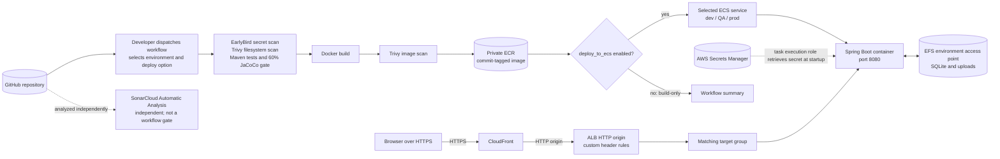

# Secure Inventory Deployment Architecture

Open the editable [AWS deployment diagram](./deployment-architecture.drawio) in diagrams.net (draw.io).

## Deployment flow

The target design has one shared ECR repository and ECS cluster, with separate dev, QA, and prod services, task definitions, target groups, EFS access points, and data. A single CloudFront hostname can expose the environments under `/dev/`, `/qa/`, and `/prod/`. The AWS resources and listener rules are being configured manually; verify each actual setting in AWS before enabling ECS deployment.

The diagram shows the intended end state, not a claim that every AWS resource is already complete. The current workflow supports the checks and build/push path; ECS deployment stays off by default. Enable it only once the selected task definition, service, network, EFS mount, secret references, and least-privilege IAM permissions are verified.

## Trivy image scan failure diagnosis

The supplied run scanned image `main-cdd418fde516` and failed in the **Trivy container image scan**. Trivy reported **38 HIGH/CRITICAL vulnerabilities (22 HIGH, 16 CRITICAL)**, all in Java dependencies inside `app/app.jar`; the Ubuntu 26.04 base image and the `pebble` Go binary each reported zero vulnerabilities. The vulnerable versions came from the Spring Boot 3.5.7 dependency set: Spring Boot 3.5.7, Jackson 2.19.2, Tomcat 10.1.48, Spring Framework 6.2.12, Spring Data 3.5.5, Spring Security 6.5.6, and Thymeleaf 3.1.3.

This was not a SonarCloud, AWS authentication, or base-image failure. The container scan is configured with `severity: CRITICAL,HIGH` and `exit-code: '1'`, so any finding at those severities fails the step. The image push is sequenced after that gate; therefore the image was not pushed and the ECS deployment could not run.

The dependency baseline has been updated to Spring Boot 3.5.16, Jackson 2.21.7, and Tomcat 10.1.62. Spring Boot's managed dependencies now resolve Spring Framework 6.2.19, Spring Data 3.5.13, Spring Security 6.5.11, and Thymeleaf 3.1.5. These versions meet or exceed the fixed versions shown in the supplied report. Maven tests and the coverage gate pass locally; a fresh GitHub Actions image scan is still required to confirm against the live Trivy vulnerability database. The workflow summary now includes the scan counts, each HIGH/CRITICAL package/advisory, installed and fixed versions, and why the gate stopped the push.

## Security controls and limitations

- **Secrets:** Administrator credentials belong in Secrets Manager and are injected by ECS at task start. The task execution role should read only the required secret; the app task role should not have that permission. Secret values must not be in Git, GitHub variables, Docker build arguments, image layers, or logs. The app BCrypt-hashes the initial admin password in SQLite; updating the secret does not rotate an already-created account.
- **CI credentials:** The current GitHub Actions setup uses a dedicated IAM user's long-lived access key as GitHub Actions secrets. This is a compromise because OIDC role assumption was not available in the account. Scope permissions narrowly, restrict workflow and secret administration, never use root keys, and rotate or revoke the key. GitHub OIDC with short-lived role credentials is the preferred design when available.
- **Build gates:** EarlyBird scans tracked application files. Trivy blocks high/critical filesystem and image findings (unfixed vulnerabilities are ignored). Maven tests and JaCoCo enforce the configured 60% line coverage. SonarCloud Automatic Analysis runs independently; it does not block this workflow's ECR push or ECS deployment.
- **Container:** The Docker image runs as a non-root user. Compose additionally uses a read-only root filesystem, drops Linux capabilities, disables privilege escalation, limits resources, and binds locally. Match these controls in ECS where supported.
- **Network and TLS:** The planned no-domain access path encrypts browser-to-CloudFront traffic with HTTPS, but CloudFront-to-ALB is HTTP. The CloudFront origin-facing prefix list permits traffic from CloudFront generally, not only this distribution; the ALB should also require the per-environment private origin header and use a fixed-response default rule. This is demo-grade, not end-to-end TLS. Do not send sensitive production data or credentials through it. For production, use a domain and TLS from the viewer through to the ALB (or another fully encrypted private origin design).
- **Persistence and availability:** Separate EFS access points keep environment directories apart, but this application uses SQLite. Run only one active task per environment and do not scale out against the same database. EFS-backed SQLite is a constrained demo design; use a managed database such as PostgreSQL for production or multiple replicas.
